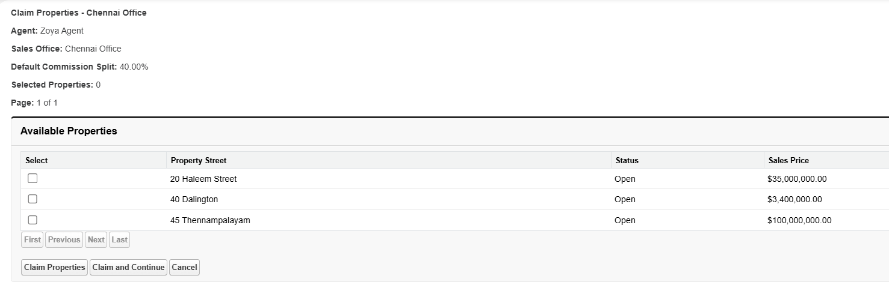
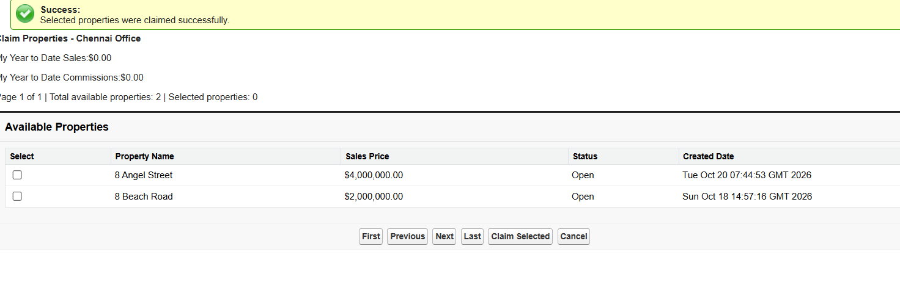
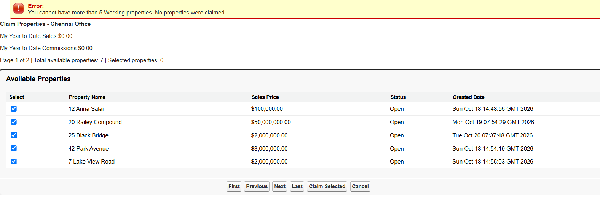
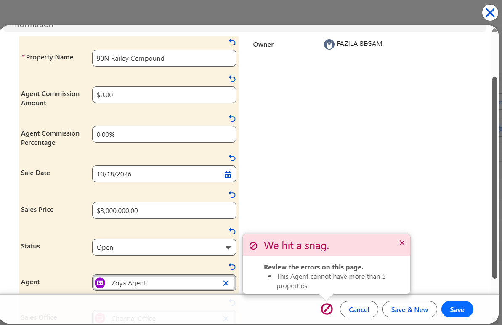
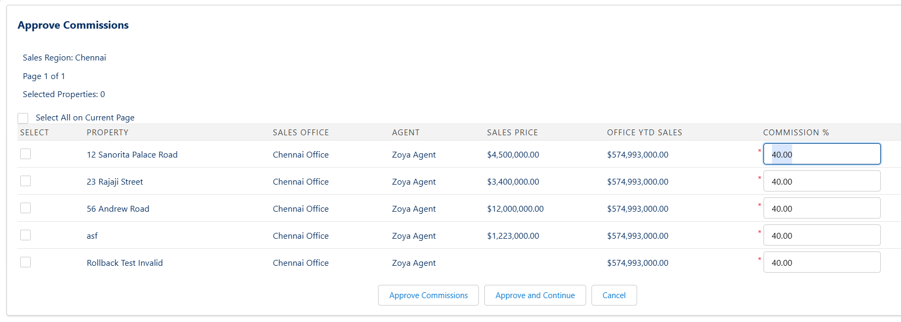
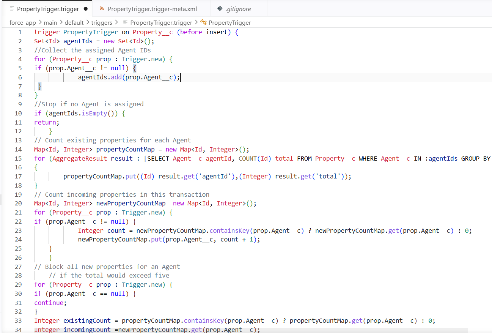
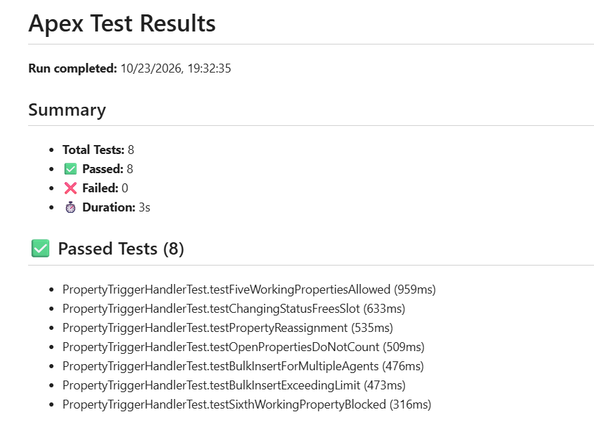
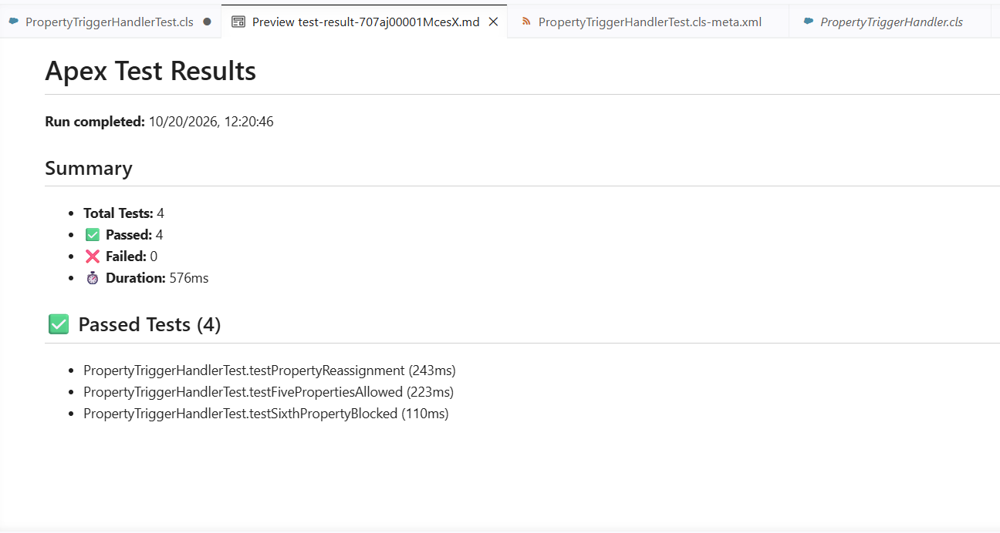
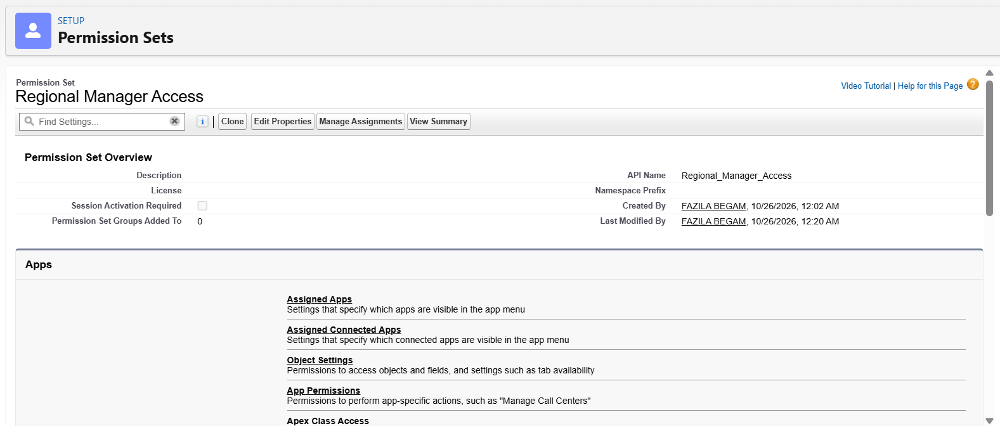
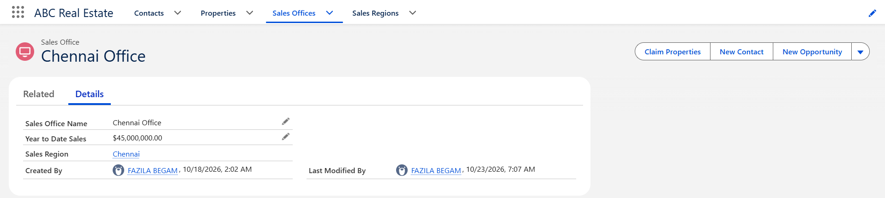

# ABC Real Estate Management System

## Salesforce Developer Portfolio Project

A Salesforce-based real estate management application developed to streamline property assignments, agent commissions, and sales approval processes.

## Project Overview

The ABC Real Estate application helps real estate organizations manage properties, sales offices, agents, and commission approvals through customized Salesforce functionality.

The project demonstrates Salesforce development concepts using Apex, Triggers, Visualforce, Flows, custom objects, and automated testing.

## Technologies Used

- Salesforce Platform
- Apex Classes and Triggers
- SOQL and SOSL
- Visualforce Pages
- Salesforce Flows
- Custom Objects and Fields
- Validation Rules
- Permission Sets
- Apex Test Classes
- Salesforce CLI

## Key Features

### 1. Property Management
- Manage properties and their sales information.
- Assign properties to real estate agents.
- Restrict agents to a maximum of five Working properties.
- Exclude Open properties from the Working property limit.

### 2. Property Claiming
- Custom Visualforce page for agents to claim available properties.
- Display properties in paginated lists.
- Retain selected properties while navigating pages.
- Prevent conflicting claims and partial updates.
- Automatically apply the agent's default commission split.

### 3. Commission Management
- Calculate property commissions using Salesforce automation.
- Display pending commissions for approval.
- Provide a custom Visualforce approval interface.
- Update property status after commission approval.

### 4. Sales Performance Tracking
- Track agent Year-to-Date sales and commission totals.
- Organize properties by sales office and sales region.

### 5. Security and Access Management
- Configure permission sets for different user responsibilities.
- Apply role-based access and record-level security.

## Salesforce Development Components

| Component | Implementation |
|---|---|
| Apex Classes | PropertyTriggerHandler, ClaimPropertiesController, ApproveCommissionsController |
| Apex Trigger | PropertyTrigger |
| Visualforce Pages | ClaimProperties, ApproveCommissions |
| Flow | Calculate_Property_Commission |
| Custom Objects | Property, Sales Office, Sales Region |
| Test Classes | PropertyTriggerHandlerTest, ClaimPropertiesControllerTest, ApproveCommissionsControllerTest |

## Testing

Dedicated Apex test classes are included to validate the application's core business logic, property assignment rules, and commission approval functionality.

## Project Structure

```text
force-app/
└── main/
    └── default/
        ├── classes/
        ├── flows/
        ├── objects/
        ├── pages/
        ├── permissionsets/
        ├── tabs/
        └── triggers/
```

## Author

**Fazila Begam**

Aspiring Salesforce Developer | Mathematics Postgraduate

GitHub: https://github.com/fazila-salesforce-dev


## Project Screenshots

The screenshots below demonstrate key workflows and implementation evidence from the ABC Real Estate Salesforce application.

### 1. Property Management and Claiming

**Claim Properties Page**



**Successful Property Claim**



**Claim Selection Limit Validation**



**Maximum Five Working Properties Validation**



### 2. Commission Approval

**Approve Commissions Page**



### 3. Apex Trigger and Testing

**Property Trigger Code**



**Apex Test Results - 8 Tests Passed**



**Apex Test Results - 4 Tests Passed**



### 4. Salesforce Configuration

**Regional Manager Permission Set**



**Chennai Sales Office**

